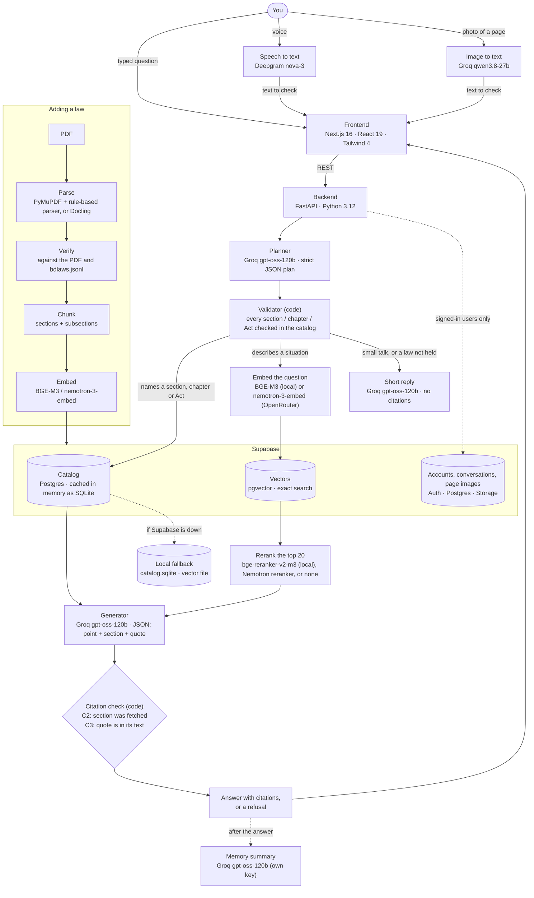

# Architecture and technology choices

## Architecture

- **Search models depend on the retrieval profile** (`RAG_RETRIEVAL`). The
  default on `main` is local BGE-M3 + bge-reranker. The deployed build (the
  `deploy` branch) runs nemotron-3-embed on OpenRouter, with no local models.
- **Every model call has a fallback:** gpt-oss-120b on its own Groq key.
  Conversation names come from Gemini 3.5 Flash Lite.
- **Keys:** Groq keys rotate per call and move on at once when one is rate-limited.

## Technology choices

Each part: what it needs, what was chosen, and what else was tried or
considered. Measurements are in `experiments.md`.

### Reading the law PDFs

**Needs:** exact section text with page numbers. Sections split across pages
must be rejoined, and the side notes kept with their section.
**Chosen:** PyMuPDF + a rule-based parser written for these Acts. Docling for
documents that aren't numbered statutes, where a person compares both on sample
pages and picks.
**Considered:**
- Docling as the main parser: lost text and broke sections that run across pages.
- LandingAI ADE: paid, and its blocks don't line up with section boundaries.
- unstructured.io: put side notes in the wrong place, and copied the contents
  pages in as fake sections.
- pdftotext / pdfplumber: lose font sizes, which the parser needs.
- pymupdf4llm: noisy output; ran OCR on PDFs that already have text.
- OCR (Tesseract and others): the PDFs already contain text, and OCR can misread
  a section number.
- An LLM reading the PDF: a guessed section number can't be checked.
- Cloud parsers (LlamaParse, Azure, Textract): cost per page for text we already have.

### Checking the parse

**Needs:** proof that no text was lost or invented, independent of the parser.
**Chosen:** re-read the PDF and compare against `bdlaws.jsonl`, an independently
scraped copy of the Acts (used only for checking, never as content).
**Considered:**
- The parser's own counts: a parser that drops text also drops it from its counts.

### Splitting into chunks

**Needs:** chunks that keep a legal rule together with its conditions.
**Chosen:** one chunk per section, split at its own subsections when too long,
plus a chunk per subsection.
**Considered:**
- Fixed-size windows: cut a condition off from its consequence.
- Semantic chunking: ignores the section boundaries the Act already draws.
- A longer heading prefix on each chunk: measured, made no difference (E2).

### Finding sections by meaning

**Needs:** find the right sections for a described situation, for free.
**Chosen:** BGE-M3 run locally (default on `main`), or nemotron-3-embed on
OpenRouter (the deployed build; higher recall, one request per question).
**Considered:**
- Voyage / Kanon legal embedders: paid.
- BM25 or hybrid keyword + vector search: published statute results show no gain.
- nemotron-embed-vl: not clearly better than BGE-M3 (E21).
- LFM-2.5 embedding: worse, and can't read chunks over 512 tokens (E21).

### Putting the best section first

**Needs:** the correct section at the top, not just somewhere in the top 20.
**Chosen:** bge-reranker-v2-m3 (+9.2 points on top-1, E4), or the Nemotron
reranker on OpenRouter (best top-1 measured, one request per question).
**Considered:**
- Qwen3-Reranker: could not be measured fairly with the tools available (E6).
- ColBERT: built for high traffic, which this app doesn't have.
- An LLM as reranker: slow, costly and not repeatable.

### Storing the law

**Needs:** exact lookups and vector search over one copy of the text, and adding
a law without redeploying.
**Chosen:** Supabase Postgres + pgvector, with exact (not approximate) search.
Local SQLite + a vector file as a logged fallback.
**Considered:**
- Local files only: a new law meant a rebuild and redeploy, and two copies of the text.
- Chroma / Qdrant: another server to run; pgvector is already in Supabase.
- An approximate vector index (HNSW): could change results, and 2,300 rows are
  fast anyway.

### Understanding the question

**Needs:** work out what kind of question it is: asking for a specific section,
describing a situation, small talk, or asking about a law the app doesn't have.
It must never guess a section number.
**Chosen:** a planner model (Groq gpt-oss-120b) that only says where to look,
such as "Penal Code, section 302". The code then checks that section exists
before fetching it.
**Considered:**
- Regex patterns: only knew phrasings someone had anticipated.
- A small model (lfm-2.6B): labelled the same question differently between runs.
- Gemini as planner: fast at first (E16), later too slow; moved to its own Groq key (E18).

### Writing the answer

**Needs:** answers that only use the fetched sections, in a form code can check.
**Chosen:** Groq gpt-oss-120b with a strict JSON schema: each point has a section
and a quote. Other models can be picked in the UI.
**Considered:**
- Free-form answers with inline citations: nothing proves a citation is real.
- Smaller models (LFM 2.6B, local Qwen2.5-VL-3B): didn't answer as expected.
  The answers were weaker, and they didn't reliably follow the answer format.
- Gemini: good answers, but too slow at times (calls of 34–64 s were seen).
- Qwen 3.8 27B, Mercury and other OpenRouter free models: still selectable, but
  slower or less reliable than gpt-oss-120b.
- Training a small model for this exact task: needs a large set of legal
  question–answer–citation examples, which is slow and costly to build.

### Checking citations

**Needs:** catch invented law before the user sees it.
**Chosen:** two checks in plain code: the cited section was fetched (C2), and the
quote appears in it word for word (C3).
**Considered:**
- A prompt telling the model to cite everything: a request, not a guarantee.
- An LLM judge: another model's opinion, not proof, and one more slow model call
  on every answer.

### Remembering the conversation

**Needs:** follow-ups like "what if he survived?" must work, without the prompt
growing forever or slowing the answer.
**Chosen:** a short rolling summary (gpt-oss-120b, own key) + the last question
and answer word for word, with section numbers copied by code. Updated after
the answer, not before.
**Considered:**
- Sending the whole history: grows every turn.
- Tracking only the sections in play: fails a changed fact ("what if he survived?").
- Gemini as summariser: took 34–64 s per call (E20).

### Voice and photo input

**Needs:** speak or photograph a question, without a misheard number silently
changing the law.
**Chosen:** Deepgram nova-3 for voice, a vision model for photos (Groq
qwen3.8-27b in the deployed build, max 3 MB). The text is shown to check
before sending.
**Considered:**
- Sending the transcript straight away: a misheard "379" becomes a different offence.
- Older Deepgram models (nova-2 and earlier): less accurate than nova-3, the newest one.
- OpenRouter ling-3.0-flash-vl: withdrawn from the free tier.
- Nemotron Nano Omni: a reasoning model that spends its budget thinking.
- Accepting PDFs here: a PDF's own text layer is more reliable; it goes through
  the parser instead.

### Model access and reliability

**Needs:** keep answering on free tiers with daily limits.
**Chosen:** several Groq keys used in turn, own keys for the planner, memory and
fallback, and quota tracked per model and key.
**Considered:**
- One key: the daily limit ran out during testing.
- Paid APIs: cost.

### Accounts and storage

**Needs:** optional sign-in; guests store nothing; users see only their own data.
**Chosen:** Supabase Auth, Postgres and Storage. Every query filters by the
signed-in user.
**Considered:**
- Saving guest chats in the browser: "nothing saved" would have been untrue.
- Building auth from scratch: more to build and more to get wrong.

### App framework

**Needs:** a chat UI with citation previews and side panels, and a Python API
for the ML code.
**Chosen:** Next.js + React + Tailwind (frontend); FastAPI (backend).
**Considered:**
- Streamlit / Gradio: quick, but can't do the citation drawer and panels.
- Flask / Django: Flask has no built-in validation or API docs; Django is more
  than an API needs.

### Deployment

**Needs:** a free public URL for both parts.
**Chosen:** Render: the backend as a Docker image (~435 MB, no local models),
the frontend as a Node service.
**Considered:**
- Google Cloud Run: needs a card on file.
- Oracle Cloud (Always Free): also needs a credit card.
- Hugging Face Spaces: public by default, and fixed port setup.
- Fly.io / Railway: no real free tier any more.
- The image with local models (~6 GB, ~2.7 GB RAM): too big for free hosts.
