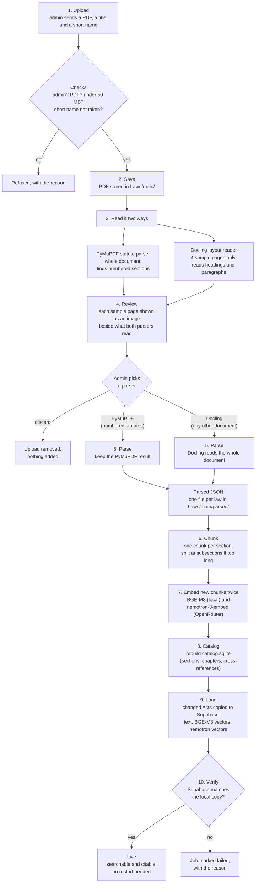

# Document ingestion pipeline

What happens, step by step, when an admin adds a new law or document. The same
steps run whether it is added from the app or from the command line.

## The flow



The job runs in the background. The admin can close the dialog at any point;
the document stays in the sources list as a grey row with its status, and
clicking it reopens the dialog.

## Step by step

### 1. Upload
The admin clicks **Add a source** and sends the PDF with a title (for example
"The Police Act, 1861"), a short name used in citations (`police_act`), and an
optional Act number. The backend checks that the user is an admin, that the file
really is a PDF under 50 MB, and that the short name is not already in use.
Anything else is refused with a clear reason.

### 2. Save
The PDF is saved in `Laws/main/`, beside the other laws. It is never overwritten
by a different file with the same name.

### 3. Read it two ways
Laws come in two shapes, and each parser is good at one:
- **PyMuPDF statute parser** reads the whole PDF and finds numbered sections
  ("302. Whoever commits murder…"), including sections that run across pages and
  the side notes in the margin. It is very accurate on Acts, but on a judgment
  or a report it finds no sections at all.
- **Docling** reads a page's layout: headings, paragraphs, lists and tables,
  whatever the numbering. It is slow, so at this point it only reads **4 sample
  pages**, one from each quarter of the document (the start, the body and the
  end fail in different ways).

### 4. Review
For each sample page the admin sees the page as an image, next to what PyMuPDF
and Docling read from it, plus a summary of the whole PyMuPDF result: how many
sections it found, how much of the text landed inside a section, and whether
the numbering is in order. The better choice is highlighted, but the admin
decides. If PyMuPDF found no sections, it can't be chosen. The admin can also
discard the upload.

### 5. Parse
- **PyMuPDF chosen:** the result from step 3 is kept. Units are called sections.
- **Docling chosen:** Docling now reads every page of the document. Units are
  called passages.

Either way the result is saved as JSON in `Laws/main/parsed/`, in the same
shape, so every later step treats both the same.

### 6. Chunk
The text is split into pieces for search: one chunk per section, and a section
longer than 512 tokens is split at its own subsections, never in the middle of
a sentence. Each subsection also gets its own chunk. Every chunk starts with
where it comes from (Act > Chapter > Section), so a search hit always knows
its place. Saved in `Laws/main/chunks/`.

### 7. Embed
Each chunk is turned into a vector, so it can be found by meaning. This is done
twice, once per search model, so every search option can find the new law:
- **BGE-M3**, run locally, for the default search.
- **nemotron-3-embed**, on OpenRouter, for the OpenRouter search options (about
  1 request per 32 chunks).

Chunks whose text already has a vector reuse it, so adding one law only embeds
that law. If OpenRouter fails (for example its daily limit), the job still
finishes; the OpenRouter search just leaves the new law out until the nemotron
vectors are built again (`python scripts/build_index.py --embedder nemotron-3-embed`).

### 8. Catalog
`catalog.sqlite` is rebuilt from all the parsed JSON: every Act, chapter,
section and cross-reference, for exact lookups like "section 302 of the Penal
Code".

### 9. Load
Each Act is copied to Supabase: its text and structure, the BGE-M3 vectors
(table `law_chunks`) and the nemotron vectors (table `law_alt_chunks`). An Act
whose content has not changed is skipped. Each Act gets a "load complete" record
written last, so a load that stops halfway is never used.

### 10. Verify
A checker reads Supabase back and compares it with the local files: section
counts, every section's text, every vector, and that a sample of searches
returns the same results. If anything differs, the job is marked failed.

### Live
The app picks up the new law right away on the server that added it, and on
any other server within a minute. It appears in the sources list, the planner
can answer questions about it, and its sections can be cited. No restart is
needed.

## Removing a source

The same pipeline in reverse. The Act is deleted from Supabase first (every
section, vector and record under it goes with it), its local files move to
`Laws/removed/<name>/` so they can be restored, and steps 7 to 10 run again.
Nothing new is embedded. The three core Acts (Penal Code, CrPC, Evidence Act)
can never be removed.

## From the command line

The same steps without the app:

```bash
cd backend
# steps 2 to 4: parse, then open the review page Laws/review/<name>/review.html
python scripts/ingest_document.py --pdf "Laws/main/The Arms Act, 1878.pdf" \
    --slug arms --name "The Arms Act, 1878" --act-no "XI of 1878"
# steps 6 to 10 (the script prints these after you choose)
python scripts/chunk_sections.py --act arms
python scripts/build_index.py
python scripts/build_index.py --embedder nemotron-3-embed
python scripts/build_catalog.py
python scripts/load_supabase.py --all
python scripts/load_supabase.py --embedder nemotron-3-embed --all
python scripts/verify/verify_supabase.py

# removing
python scripts/remove_act.py --act arms
```

## Code

| step | file |
|---|---|
| upload, jobs, review, build | `backend/app/ingest/sources.py`, `backend/app/api/routes/sources.py` |
| the dialog and grey rows | `frontend/components/sources/AddSourceDialog.tsx`, `frontend/components/layout/StatuteBrowser.tsx` |
| PyMuPDF parser | `backend/scripts/parse_law_pdf.py` |
| Docling parser | `backend/scripts/parse_docling_document.py` |
| sample pages, review page | `backend/scripts/ingest_document.py` |
| chunk / embed / catalog / load / verify | `chunk_sections.py`, `build_index.py`, `build_catalog.py`, `load_supabase.py`, `verify/verify_supabase.py` in `backend/scripts/` |
