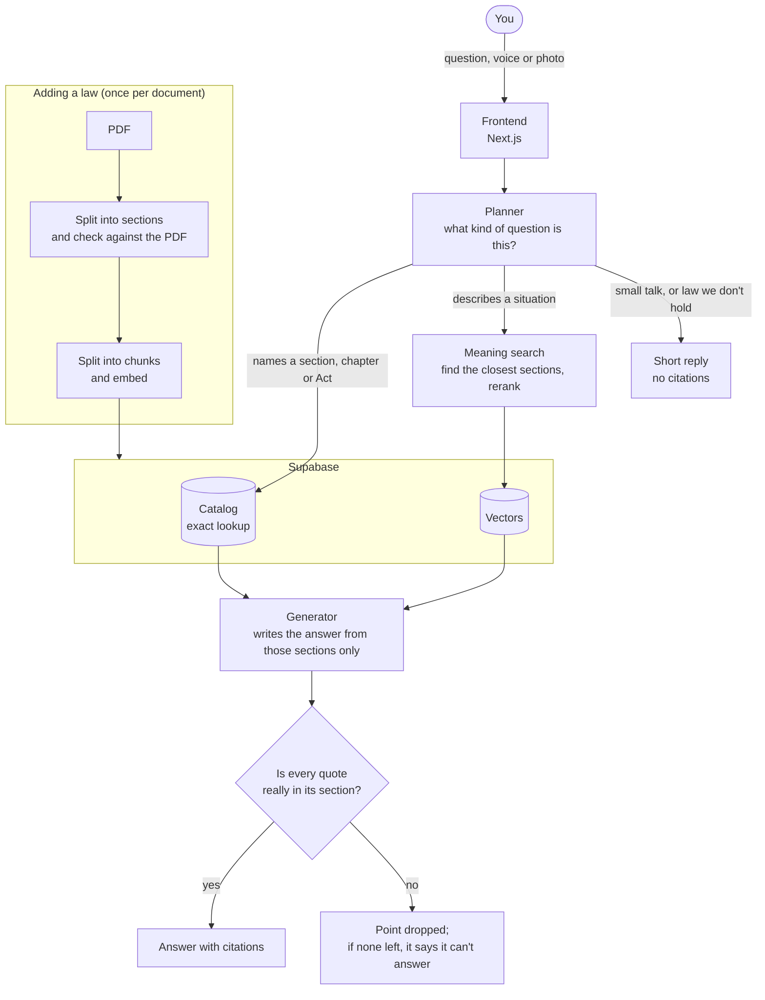

# আইনসংলাপ (AinShonglap)

A Bangladesh criminal-law assistant that answers from the statute text and cites
the exact sections it used. It covers the Code of Criminal Procedure 1898, the
Penal Code 1860 and the Evidence Act 1872; admins can add more sources.
When the Acts do not support an answer, it says so instead of guessing.

> Legal information, not legal advice.

**Live demo: https://ainshonglap.onrender.com/**

It runs on Render's free tier, which puts the backend to sleep when idle. The
first visit wakes it up, and that takes about a minute. If the model list or
the Acts show as unavailable, wait a minute and reload.

## Run it

You need conda, Node 20.9+, a Supabase project and a Groq API key. From the
repository root:

```bash
./run_backend.sh      # http://localhost:8000
./run_frontend.sh     # http://localhost:3000
./run_docker.sh       # optional: the backend in Docker instead
```

The first run creates `backend/.env.local` from the example. Fill in the keys
and run it again.

**Keys** go in `backend/.env.local` (see `backend/.env.example`):

| | keys |
|---|---|
| Required | `GROQ_API_KEY`, `SUPABASE_URL`, `SUPABASE_SERVICE_ROLE_KEY` |
| More Groq capacity | `GROQ_API_KEY_2`, `_3`, `GROQ_API_KEY_PLANNER`, `GROQ_API_KEY_SUMMARIZER`, `GROQ_API_KEY_FALLBACK` |
| Features | `OPENROUTER_API_KEY` (image reading), `DEEPGRAM_API_KEY` (voice), `GEMINI_API_KEY_3` (conversation names), `ADMIN_EMAILS` (who can add sources) |

## Basic architecture



1. **You ask.** Type a question, speak it, or send a photo of a page. Voice and
   photos are turned into text that you check before sending.
2. **The planner reads it** and decides what kind of question it is. It never
   writes the answer; it only says where to look.
3. **The right sections are fetched.** A named section ("section 302") is looked
   up exactly. A situation ("someone broke into my shop") goes to meaning
   search, which finds the closest sections and puts the best first. Small talk,
   or a law the app doesn't hold, gets a short reply with no citations.
4. **The answer is written from those sections only.** Every point names its
   section and quotes it.
5. **Every quote is checked** against the section's real text. A point whose
   quote isn't there is dropped. If nothing is left, the app says it can't
   answer instead of guessing.
6. **Follow-ups work** because a short summary of the conversation is kept and
   sent with the next question.

**Adding a law** happens once per document: the PDF is split into sections,
checked against the PDF, cut into chunks, embedded, and stored in Supabase. The
app picks it up within a minute, without a restart.
Can only be done by admin

Every step of adding a document, with a diagram, is in
[Docs/ingestion.md](Docs/ingestion.md).

**Built with:** Next.js (frontend), FastAPI (backend), Supabase (Postgres +
pgvector, optional accounts), Groq `gpt-oss-120b` (planner and answers),
BGE-M3 + a cross-encoder reranker (search; OpenRouter options via
`RAG_RETRIEVAL`).

For the detailed architecture (the exact model, database and service at each
step) and why each technology was chosen over the alternatives, see
[Docs/architecture.md](Docs/architecture.md).

## Main features

- **Answers with checked citations**: every point quotes its section, and code
  checks the quote is really in it; points that fail are dropped.
  `backend/app/rag/verify.py`
- **Exact lookups and meaning search**: a planner decides whether you named a
  section (fetched exactly) or described a situation (searched by meaning).
  `backend/app/rag/plan.py`, `execute.py`, `catalog.py`
- **Explains a section on request**: "explain section 302" breaks it into its
  parts (what it covers, conditions, punishment, exceptions), each quoted.
  `backend/app/rag/execute.py`
- **Honest refusals**: if the Acts don't cover a question it says so, and shows
  the sections it looked at as clickable previews. `backend/app/rag/present.py`
- **Remembers the conversation**: a short summary plus the last question and
  answer, updated after each answer without slowing it down.
  `backend/app/rag/memory.py`, `pending_memory.py`
- **Voice and photo input**: speech (Deepgram) or a photo of a page becomes
  text you check before sending. `backend/app/rag/speech.py`, `vision.py`
- **Add and remove laws from the app** (admins): upload a PDF, compare two
  parsers on sample pages, pick one; it is indexed in the background and live
  within a minute. `backend/app/ingest/sources.py`, `frontend/components/sources/`
- **Several models, never stuck**: pick the answer model; API keys rotate, and
  every model call has a fallback. `backend/app/rag/llm.py`, `keyring.py`, `quota.py`
- **Optional accounts**: guests store nothing; signed-in users get saved,
  auto-named conversations, each visible only to its owner.
  `backend/app/db/conversations.py`, `backend/app/rag/naming.py`
- **Laws served from Supabase**: Postgres for exact lookups, pgvector for
  search, with local copies as a logged fallback. `backend/app/rag/corpus_db.py`

**More detail:**
[architecture and technology choices](Docs/architecture.md) ·
[adding a document, step by step](Docs/ingestion.md) ·
[experiments summary](Docs/experiments-summary.md) ·
[full experiment log](Docs/experiments.md) ·
[how AI was used](AI_USAGE.md)

## Evaluation

The system was checked in three ways.

**1. Retrieval, against known answers.** The Bangladesh legal QA dataset
(`Laws/bangladesh-legal-qa-dataset`, not in the repository) has 2,165 questions,
each tagged with the Act and section that answers it. Questions answered by an
Act this app doesn't hold were left out, leaving **608 questions**. For each
one, the retrieved sections were compared with the expected section:

- was the right section found?
- how high was it ranked?
- did the top result come from the right Act?

Retrieval was scored on all 608 questions. Checking the full written answers
needs several model calls per question, and the free API daily limits made that
impossible for the whole set; one OpenRouter search combination also stopped at
119 of 608. The separate `bdlaws.jsonl` copy of the Acts was used to check the
parsed law text, not the answers.

```bash
cd backend && python scripts/eval_retrieval.py
```

**2. The planner, question type by question type.** The planner sorts each
question into a type (a named section, a situation, a document, small talk, a
law the app doesn't hold, a question about the app). Several questions were
written for each type and checked to see that each went to the right type:
about 40 in a graded set (`scripts/experiments/plan_cases.py`) and 15 walked
through step by step and read by hand (`scripts/check_questions.py`).

**3. A law student's review.** After deployment, a law student from the
University of Dhaka used the live app. The answers quoted the Acts word for word
and nothing wrong was found; the main limit was the small number of Acts it has
in its source index.

## Experiments and results

20 experiments are documented. More were run than that: model speed tests,
the parser comparisons (8 PDF parsers tried) and the chunking trials were not
all written up as experiments. A change was kept only if it improved a measured
number. How the documented ones shaped the current system:

- **Search (8 experiments).** Chunk size and chunk headings made no difference.
  A reranker was the first clear win, and indexing subsections as well as
  sections found more. A low-score refusal threshold was tested and dropped as
  too costly. Free OpenRouter models were then tested and two beat the local
  pipeline, so they became options (the deployed site uses one).
- **Answering (5).** A model without retrieval invented law, so retrieval and
  quote-checked citations are mandatory. Groq was chosen for speed and a strict
  answer format; Mercury was slower here. One traced refusal showed the answer
  prompt is too strict for "am I guilty if…" questions.
- **Planning and data (5).** An exact-lookup catalog was built for named
  sections and chapters. A planner model replaced pattern matching (42 of 42
  test questions routed right), moved to its own key, and learned to handle two
  Acts in one question. Moving the laws to Supabase changed no result.
- **Memory and voice (2).** Both work in use; memory moved off Gemini after its
  calls took up to a minute.

Each experiment's purpose and result: [Docs/experiments-summary.md](Docs/experiments-summary.md).

## Limitations and future improvements

**Limitations**

- **Slow answers.** One question makes several model calls (planner, search,
  answer, memory), so answers take a few seconds or more.
- **Hard-to-parse PDFs.** Law PDFs vary a lot in layout, so reading them into
  clean sections, and splitting those into good chunks, is difficult for new
  documents.
- **No Bangla support.** Bangla laws are not included, and voice input doesn't
  handle Bangla (or Bangla mixed with English).
- **Free-tier limits.** Daily API limits cap how many questions, page images and
  voice clips can be processed; images are one page and at most 3 MB.
- **General-purpose models.** The answering models are not trained on law, and
  only a handful of Acts are loaded.

**Future improvements**

- Fine-tune a model on Bangladesh law, or use a legal-specific model, for
  better answers.
- Replace the planner with a small model fine-tuned for sorting questions, for
  much lower latency.
- Add Bangla laws and Bangla voice input.
- Improve parsing and chunking for PDFs with unusual layouts.

## AI usage

AI (mainly Claude Code with Claude Sonnet 5) was used for research and for
writing most of the code; every choice was tested before it was kept. What
it was used for, how its output was checked, and which of its suggestions
were rejected: [AI_USAGE.md](AI_USAGE.md).
